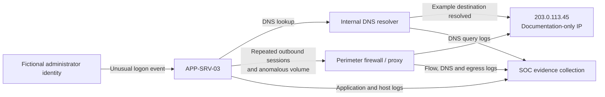

# Incident 03 — Network Intrusion and Simulated Data Exfiltration

> © 2026 Denis Dallas. Licensed under [CC BY 4.0](../LICENSE-CC-BY-4.0). For reuse, credit Denis Dallas, SOC & DFIR Investigations, link to the repository and license, and indicate changes.
Fictional portfolio simulation · Network security investigation · Severity: High (simulated)

> **Disclaimer:** This case is entirely fictional. All systems, events, users, and indicators are synthetic. IP addresses are reserved documentation ranges under RFC 5737; domains use reserved example domains. No real organization, victim, attacker, or data transfer is represented.

## 1. Executive summary

A fictional SOC detects unusual outbound traffic from an internal application server to an unfamiliar external destination. Network telemetry shows repeated outbound connections and a transfer-volume increase outside the server's normal operating profile. Authentication records also show an unusual administrative logon to the same host before the outbound activity.

The investigation correlates firewall, DNS, proxy, identity, and server telemetry to assess whether the activity represents unauthorized access and possible data movement. The simulated records support suspicious access and anomalous egress. They do **not**, by themselves, prove that sensitive data was successfully exfiltrated. The content and business sensitivity of any transferred bytes remain unverified.

**Severity rationale:** High, because an application server and potentially sensitive outbound communications are involved.

## 2. Scope and objectives

**In-scope assets**
- Fictional application server: `APP-SRV-03`
- Fictional administrator identity: `svc-maint@example.com`
- Perimeter firewall, DNS resolver, web proxy, and network-flow telemetry
- Relevant server authentication and application logs

**Objectives**
- Validate the unusual outbound traffic alert.
- Reconstruct the sequence of authentication and network events.
- Determine whether the source host was accessed without authorization.
- Assess whether outbound traffic can be tied to specific files or data.
- Identify containment steps and improve egress monitoring.

## 3. Simulated network-flow diagram

The diagram illustrates the fictional environment and observed investigative path. It is not a real network topology.

## 4. Simulated timeline

All times are illustrative UTC.

| Time (UTC) | Event | Assessment |
|---|---|---|
| 14:02 | Administrative logon to `APP-SRV-03` from an unusual internal source | Identity/server logs; observed |
| 14:08 | Server queries `updates-check.example.net` | DNS log; observed |
| 14:09 | Firewall records outbound connection to `203.0.113.45` | Network flow; observed |
| 14:12 | Repeated outbound sessions begin | Flow telemetry; observed |
| 14:18 | Outbound byte count exceeds the server's simulated baseline | Anomaly; observed |
| 14:24 | Proxy records a request to the example domain | Proxy metadata; observed |
| 14:31 | SOC blocks the destination in the simulation and restricts server egress | Response action |
| 14:40 | Server access is limited to approved management paths | Response action |
| 15:05 | Host, identity, DNS, and firewall evidence preservation begins | Investigation action |

A high outbound byte count is evidence of network transfer volume, not proof of what the traffic contained or whether it represented stolen data.

## 5. Evidence sources and forensic methodology

| Evidence ID | Source | Purpose |
|---|---|---|
| N-01 | Firewall connection and flow logs | Source/destination, ports, bytes, duration, connection outcomes |
| N-02 | DNS resolver logs | Query chronology, response records, queried host |
| N-03 | Web proxy logs | URL metadata, methods, response codes, transfer sizes where logged |
| N-04 | Server authentication and system logs | Logon source, account, privilege use, process and service events |
| N-05 | Application logs | Requests, errors, upload/download behavior, application account activity |
| N-06 | NetFlow or equivalent telemetry | Traffic patterns, protocol, volume, timing |
| N-07 | Endpoint collection | Processes, scheduled tasks, services, temporary files, relevant artifacts |

**Method**
1. Define the alert window and preserve the original alert and raw telemetry.
2. Normalize timestamps to UTC and document clock drift between sources.
3. Identify the internal source host and correlate its DNS, proxy, firewall, and endpoint activity.
4. Review authentication context, source device, account privilege, and preceding administrative actions.
5. Examine process-to-connection attribution where endpoint telemetry supports it.
6. Assess whether any file access, archive creation, staging, or transfer evidence exists.
7. Determine the amount of traffic observed and the limits of what that metric proves.
8. Record confirmed observations, hypotheses, and unresolved evidence gaps separately.

## 6. Simulated indicators

| Type | Value | Context |
|---|---|---|
| Internal host | `APP-SRV-03` | Fictional application server |
| Account | `svc-maint@example.com` | Fictional administrative/service identity |
| Domain | `updates-check.example.net` | Reserved example domain |
| IPv4 | `203.0.113.45` | Documentation-only destination |
| Protocol | `TCP` | Simulated outbound sessions |
| Port | `443` | Encrypted web traffic; content not visible from flow metadata alone |

These are training indicators only. Do not block or investigate them as live malicious infrastructure.

## 7. Analysis and findings

### Observed in the simulation
- An unusual administrative logon occurred on `APP-SRV-03`.
- The server queried a reserved example domain shortly afterward.
- Firewall and proxy telemetry recorded outbound sessions to the documentation-only destination.
- The aggregate outbound byte count exceeded the fictional baseline.
- The timing links the server activity and network anomaly closely enough to justify a coordinated investigation.

### Assessment
The evidence supports suspicious administrative access followed by anomalous outbound network activity. This is consistent with possible command-and-control, unauthorized remote service use, or data movement, but the available metadata does not discriminate conclusively among those explanations.

### Data-exfiltration assessment
**Potential exposure: under investigation. Confirmed exfiltration: not established.**

To substantiate exfiltration, investigators would need evidence such as:
- A process on the host tied to the outbound connection.
- File access or collection activity preceding the transfer.
- Archive or staging artifacts.
- Proxy or application records identifying uploaded objects.
- Packet capture or endpoint telemetry sufficient to characterize the transfer.
- Destination-side confirmation or other independent corroboration.

Encrypted TLS flow metadata generally reveals connection characteristics and volume, not the plaintext content. Do not equate outbound bytes with stolen records.

### Not established
- The identity or intent of the operator.
- Whether the administrative logon was unauthorized.
- Whether the external endpoint was controlled by an attacker.
- Whether sensitive files were accessed, staged, or transferred.
- Whether the traffic was malicious, a misconfigured integration, or an approved maintenance process.

## 8. MITRE ATT&CK mapping

| Technique | ID | Simulated relevance |
|---|---|---|
| Valid Accounts | T1078 | Unusual administrative identity use; authorization must be validated |
| Remote Services | T1021 | Investigate the access mechanism if remote-service telemetry supports it |
| Application Layer Protocol: Web Protocols | T1071.001 | HTTPS-like outbound traffic; not sufficient alone to establish C2 |
| Exfiltration Over C2 Channel | T1041 | Hypothesis only; data theft is not confirmed |
| Exfiltration Over Web Service | T1567 | Consider if evidence shows use of a web service for transfer |

These are candidate mappings. A technique should be marked confirmed only when evidence demonstrates the relevant behavior.

## 9. Containment, eradication, and recovery

### Containment
- Restrict server egress to documented business destinations and required ports.
- Block a destination only after validating the indicator and assessing business impact.
- Limit administrative access to approved management hosts and MFA-protected pathways.
- Disable or rotate the affected identity if unauthorized use is substantiated or risk warrants it.
- Preserve network and host evidence before logs expire.
- Consider isolating the server if active compromise is likely and service continuity permits.

### Eradication
- Identify and remove unauthorized accounts, keys, scheduled tasks, services, and remote-access mechanisms.
- Patch the exploited service or close the exposed management path once the entry point is understood.
- Rotate credentials and secrets accessible from the server.
- Validate application dependencies and approved integrations before restoring unrestricted connectivity.

### Recovery
- Restore the service from a trusted state if host integrity cannot be established.
- Reintroduce egress in stages using an approved destination allowlist.
- Monitor identity, process-to-network, DNS, and outbound-volume telemetry.
- Validate application function with the system owner.
- Document whether any notification or regulatory assessment is required based on confirmed data access and applicable obligations.

## 10. Remediation and lessons learned

**Network controls**
- Implement egress filtering and destination allowlisting for sensitive server tiers.
- Segment application servers from user and management networks.
- Monitor DNS for newly observed domains, unusual query patterns, and direct-to-IP connections.
- Retain firewall, proxy, DNS, and flow logs centrally with synchronized time.

**Identity and endpoint controls**
- Use dedicated managed service identities with least privilege and managed credential rotation.
- Require MFA and privileged access workflows for administrative access.
- Alert on service-account interactive logons and unusual source hosts.
- Deploy endpoint telemetry capable of correlating process activity with network connections.

**Detection opportunities**
- Unusual administrative logon followed by new external DNS resolution.
- Server egress to a destination absent from its normal baseline.
- Large outbound transfers outside expected maintenance windows.
- Archive creation or unusual file reads followed by outbound connections.
- Service identities authenticating from unexpected hosts or interactive sessions.

## 11. Conclusion

The simulated investigation identifies suspicious administrative access and anomalous outbound traffic from an application server. The available evidence justifies containment and deeper forensic review, but it does not prove data exfiltration. The report deliberately distinguishes network-volume anomalies from confirmed transfer of sensitive information.

## 12. Evidence limitations

No packet capture, server disk image, memory image, raw application export, or destination-side evidence is included. The scenario demonstrates how to correlate network and host telemetry while maintaining an evidence-based threshold for claims of compromise and data theft.

## Reproducible sample evidence

The corresponding fictional timeline is available in the [normalized sample events](../evidence/events.csv) and [evidence guide](../evidence/README.md). From the repository root, run `python scripts/summarize_case.py INC-03` to review it. The [query examples](../queries/README.md) show how to correlate DNS, firewall, proxy, and server events in a lab.
